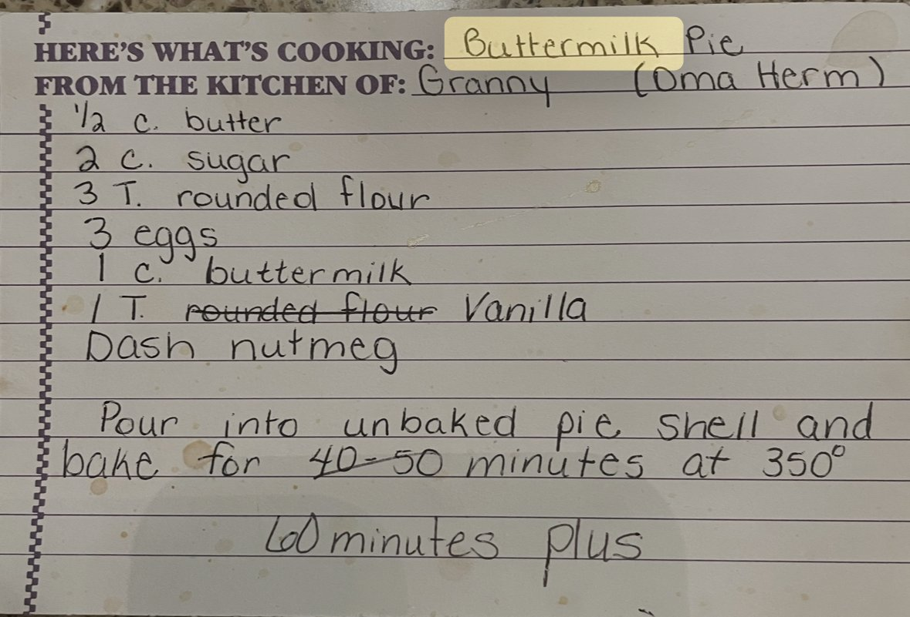

## Ingredients
- 1 unbaked 9-inch pie shell
- 1/2 cup butter, melted
- 2 cups sugar
- 3 rounded tablespoons flour
- 3 eggs
- 1 cup buttermilk
- 1 tablespoon vanilla
- Dash nutmeg

## Instructions
1. Preheat the oven to 350°F.
2. Beat 1/2 cup melted butter with 2 cups sugar and 3 rounded tablespoons flour until combined.
3. Beat in 3 eggs, one at a time.
4. Stir in 1 cup buttermilk, 1 tablespoon vanilla, and a dash of nutmeg until smooth.
5. Pour the filling into 1 unbaked pie shell.
6. Bake at 350°F for 60 minutes or more, until the top is golden and the center is just set with a slight jiggle.
7. Cool completely on a rack before slicing.

## Notes
- From the kitchen of Granny (Oma Herm).
- The card only says to pour the filling into the shell and bake, so the mixing steps above follow the usual method for buttermilk pie.
- The card first said bake 40–50 minutes. That was crossed out and "60 minutes plus" was added below it.
- On the vanilla line, "rounded flour" is crossed out and replaced with "Vanilla". 1 tablespoon is a lot of vanilla, but it's what the card says.
- If the crust edges brown too fast, cover them with foil partway through baking.

