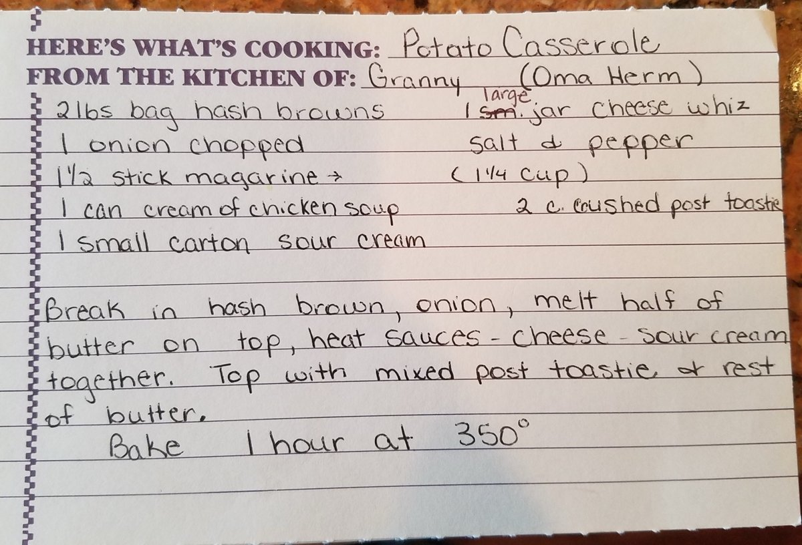

## Ingredients
- 2 lb bag frozen hash browns
- 1 onion, chopped
- 1 1/2 sticks margarine (or butter), divided
- 1 can (10.5 oz) cream of chicken soup
- 1 small carton (8 oz) sour cream
- 1 large jar Cheez Whiz
- Salt and pepper
- 2 cups crushed Post Toasties (corn flakes)

## Instructions
1. Preheat the oven to 350°F.
2. Break up the 2 lb bag hash browns into a baking dish and scatter 1 chopped onion over them.
3. Melt 3/4 stick margarine and pour it over the top.
4. In a saucepan, heat 1 can cream of chicken soup, 1 large jar Cheez Whiz, and 8 oz sour cream together until smooth. Season with salt and pepper and pour over the potatoes.
5. Melt the remaining 3/4 stick margarine and mix it with 2 cups crushed Post Toasties. Sprinkle over the casserole.
6. Bake 1 hour at 350°F.

## Notes
- From the kitchen of Granny (Oma Herm).
- The card has "(1 1/4 cup)" written with an arrow from the margarine line; 1 1/2 sticks is 3/4 cup, so that note may refer to something else.
- The card originally said a small jar of Cheez Whiz, corrected to large.
- Post Toasties are corn flakes; any plain corn flake cereal works.

